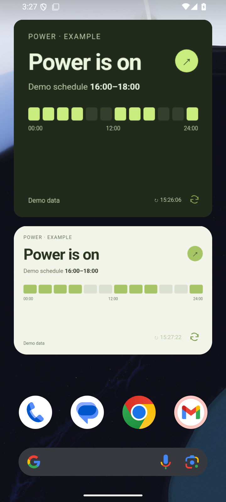
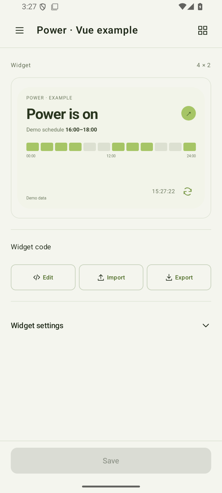
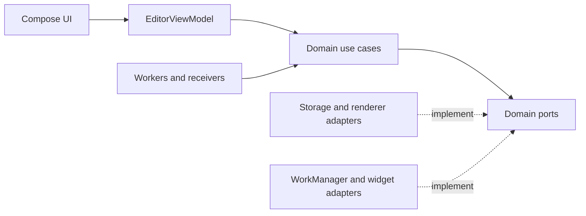

# Kadr

[](https://github.com/TheBifel/Kadr/actions/workflows/android.yml)

**Your data. Your layout. One Android widget.**

Kadr turns an HTML page with CSS and JavaScript into a home screen widget. The page fetches data, runs your logic and draws a composition. Kadr captures a static frame, closes the renderer and displays that frame until the next successful update.

[Download APK](https://github.com/TheBifel/Kadr/releases/latest) · [Architecture](docs/ARCHITECTURE.md) · [Build and test](docs/BUILDING.md) · [Українською](README.uk.md)

## Why Kadr?

Useful information is often available through an API, but its Android app has no widget—or its widget cannot show the layout you need. Building a separate native app for every small dashboard is a lot of work. A manually supplied image or JSON file still needs someone to update it.

With Kadr, the widget's page gets and processes its own data. You can write it yourself or copy the built-in AI instructions to generate it. There is no Kadr server, account or separate backend to maintain.

Examples include power outage schedules, weather, transit departures, service status, personal dashboards, and charts from your own API. Vue is bundled for pages that prefer it; plain JavaScript, SVG and Canvas also work.

## What it does

- Edit full HTML/CSS/JavaScript, start from a preset, or import/export an HTML file.
- Preview current code without saving. A single editor has collapsible code/settings, adjacent import/export controls and a swipe-open drawer for templates and references. Manage and delete independent projects.
- Refresh manually or on a configurable background schedule. Keep the last successful frame when the network, JavaScript or rendering fails.
- Restore saved projects, widget bindings and cached frames after reboot and unlock.
- Follow the system theme or select light/dark per widget. Follow the system language: Ukrainian for `uk`, English otherwise.
- Copy the SDK contract or **English-only AI instructions**, including the contract and layout rules.
- Place the native timestamp and refresh button over the bottom-right corner. The HTML owns its spacing and receives the entire widget viewport.

Android 12+ is required. The application UI uses Jetpack Compose; home screen widgets use Jetpack Glance.

## How to use it

1. Create a project or choose a preset. Put your data fetching and drawing logic in the page.
2. Use the refresh icon on the preview to check your current code. **Save** applies it to the project's existing widget.
3. Expand **Widget settings** for name, appearance and schedule. After saving, choose **Add to home screen**.
4. Tap the frame to edit it, or ↻ to refresh without opening the editor.

The page must call `await Kadr.ready()` when its content is ready, or `Kadr.fail(message)` on failure. It receives the effective theme, locale, viewport size, color tokens and native control-area dimensions. Reserve the bottom-right corner in HTML; Kadr does not inject padding or a footer strip.

Read the canonical [English SDK contract](app/src/main/assets/contracts/sdk-en.txt) or [AI prompt](app/src/main/assets/contracts/ai-en.txt). The [example pages](app/src/main/assets/templates) are included in the app.

<p>


</p>

## Architecture

Kadr has two Gradle modules:

| Module / package | Responsibility |
| --- | --- |
| `:domain` | Pure Kotlin models, policies, ports and use cases. No Android or UI dependencies. |
| `:app/data` | SharedPreferences/JSON mapping, atomic frame files, bundled content and WebView rendering. |
| `:app/presentation` | Immutable editor state, ViewModel events, Compose screens, components and theme. |
| `:app/platform` | WorkManager, Glance widget host, system locale/theme, file access and pin requests. |
| `:app/di` | Constructor injection and the application dependency graph. |



See [Architecture](docs/ARCHITECTURE.md) for the update lifecycle, boundaries, compatibility decisions and ownership rules.

## Build

Install JDK 17 and Android SDK platform 36, then configure `JAVA_HOME` and `ANDROID_HOME` for your machine:

```bash
./gradlew :domain:test :app:assembleDebug :app:assembleDebugAndroidTest :app:lintDebug
```

The APK is `app/build/outputs/apk/debug/app-debug.apk`. A prebuilt **debug APK** and its checksum are attached to [GitHub Releases](https://github.com/TheBifel/Kadr/releases). This project is not published to Google Play.

For emulator tests, formatting, optional signing variables and CI, see [Build and test](docs/BUILDING.md). No API key or app credential is required to build Kadr. Local configuration, signing keys and credentials are excluded from Git.

## Practical limits

The widget displays a snapshot: HTML buttons, scrolling, animations and persistent JavaScript are unavailable between updates. The native refresh button remains interactive. Rendering has a 15-second limit, HTTPS requests obey browser CORS rules, and arbitrary Android/file access is not exposed to the page.

Background updates use WorkManager. The minimum periodic interval is 15 minutes, and Android may delay it. Reboot recovery starts after unlock; Direct Boot is outside this version. Force stop and restrictive device battery settings can prevent background work until Android permits it again. Physical-device/OEM behavior needs testing beyond the API35 emulator used for development.

## Development

[Contributing](CONTRIBUTING.md) · [Security](SECURITY.md) · [1.1.0 verification](specs/003-minimal-editor/verification.md) · [Product specification](specs/001-programmable-widget/spec.md)

Bundled Vue is distributed under its [MIT license](app/src/main/assets/VUE-LICENSE.txt).

## License

Kadr is licensed under the [Apache License 2.0](LICENSE). See [NOTICE](NOTICE) for third-party notices. Bundled Vue retains its MIT license.
