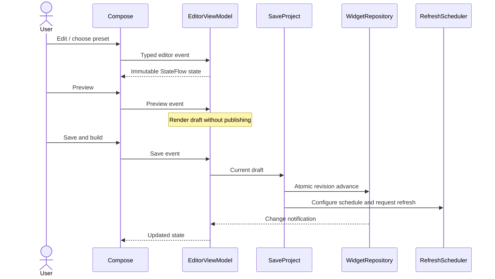

# Architecture

Kadr 1.0.0 uses constructor injection and a separate Kotlin/JVM domain module. The inner module cannot import Android, Compose, WebView, JSON, WorkManager or the app module. Android implementations depend on domain interfaces.

## Modules and responsibilities

```text
domain/src/main/kotlin/com/thebifel/kadr/domain/
  model/       Project, FrameState, environment and widget policies
  port/        Repository, image/renderer, scheduler, host and template interfaces
  usecase/     Save, delete, bind, request refresh, reconcile and render/publish
app/src/main/java/com/thebifel/kadr/
  data/        Preferences/JSON, atomic PNG files, assets, WebView adapter
  presentation/editor/  StateFlow ViewModel, typed events, screens and dialogs
  presentation/theme/   System-aware Material theme
  platform/    Locale, documents, WorkManager and Glance adapters
  di/          AppContainer: the application dependency graph
  *.kt         Stable manifest and Worker entry points
```

`AppContainer` wires ports to adapters once per application process. The same `RefreshProject` instance is shared by Workers, so per-project mutexes serialize publication. There is no service locator inside domain and no DI framework dependency.

## Editor



The ViewModel owns independent drafts, dirty flags, preview jobs and images. Composables render `EditorUiState` and send `EditorEvent`; they do not read preferences, write files or enqueue work. Activity results, clipboard and widget pinning are Android effects, outside Compose state. Preview error copying uses the same platform-action boundary. The renderer enriches failures with JavaScript call sites, geometry and recent WebView events; domain/persistence retain bounded detailed diagnostics (65,536 characters) without changing persisted field names. Drafts survive Activity recreation. Saved projects persist across process death; unsaved drafts are not stored in a large saved-instance-state Bundle.

Storage work and image decoding run on IO; WebView operations run on the main looper because Android requires it. Cancellation stops and destroys an in-flight preview. New previews replace older requests; a late result cannot update a deleted or changed draft.

## Refresh and persistence

1. `RequestRefresh` marks pending state without touching the cached PNG or success timestamp, updates the host, and asks the scheduler to enqueue work.
2. `RefreshWorker` delegates to `RefreshProject`. It loads the current revision, resolves theme/language and obtains the full viewport.
3. `WebViewFrameRenderer` loads HTML on a private virtual display/Presentation, waits for explicit `Kadr.ready()`, fonts/images and a visual-state callback, then captures a bounded bitmap. It closes the WebView and display on success, failure, cancellation or timeout. No editor Activity is opened.
4. `PreferencesWidgetRepository` checks the revision under a lock. `AtomicFrameFiles` commits the new PNG before preferences point to it. Only then is the previous PNG deleted. A failed or superseded render retains the last success.
5. Glance shows the cached image. Native time and refresh controls overlay the bottom-right corner; HTML owns its clearance.

`FrameImage` keeps Android Bitmap out of domain. Refresh owns and closes transient images after publication. Presentation retains images referenced by state; replaced UI images become eligible for garbage collection instead of being recycled while Compose may still draw them.

The existing storage engine is retained for upgrade compatibility: preferences `kadr`, `project.*`, `frame.*`, `binding.*` and `files/frames/*.png`. JSON mapping belongs to data. Legacy projects without `autoTheme` keep their explicit theme. Saving advances the revision atomically. Deletion removes project/frame/bindings, cancels both scheduling paths and resets affected widget cards; late render/error callbacks cannot recreate deleted data.

## Android lifecycle and compatibility

Manifest entry point names and `com.thebifel.kadr.RefreshWorker` remain stable. Installed widget bindings reference the receiver component, and WorkManager stores Worker class names. Changing these casually would break an upgrade even if source packages looked cleaner.

`RecoveryReceiver` reconciles schedules and republishes cached widgets after boot/package replacement; network pages can wait for connectivity. Receivers perform bounded delegation, not HTML rendering. The Glance receiver already owns its broadcast `PendingResult`; its overrides only enqueue work synchronously rather than calling `goAsync()` a second time.

Unique work names `periodic.<id>` and `manual.<id>` are unchanged. Manual work is expedited with quota fallback, API pages declare connectivity, and local pages can explicitly opt out. Scheduling is inexact. Theme/language changes refresh appropriate bound projects. The app follows system locale, with English fallback. AI instructions always contain the English prompt and contract.

## Testing and extension

Domain tests use fake ports to check cache preservation, revision safety, cancellation, independent bindings and concurrent refresh serialization. Instrumentation checks real WebView pixels, Vue/Canvas/fetch, storage compatibility, WorkManager, localization, clipboard and editor touch flows. Upgrade/native refresh/reboot are also checked on the launcher.

A new storage backend implements `WidgetRepository`; another renderer implements `FrameRenderer`. Keep JSON, Android contexts and framework types outside domain. Add a use case when an operation coordinates ports or contains shared behavior; do not create pass-through classes for every getter.

References: [Android architecture](https://developer.android.com/topic/architecture), [recommendations](https://developer.android.com/topic/architecture/recommendations). Kadr's inner boundary is enforced by its JVM module; Android data/presentation/platform separation uses packages and constructor interfaces.
